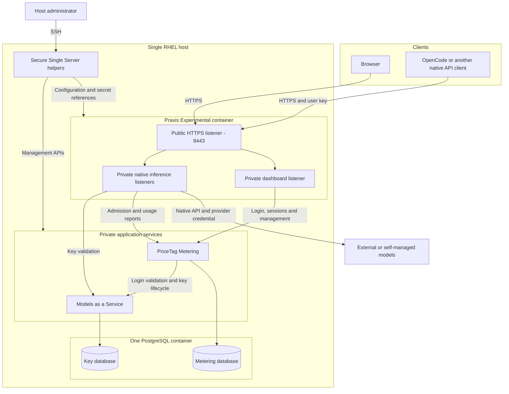
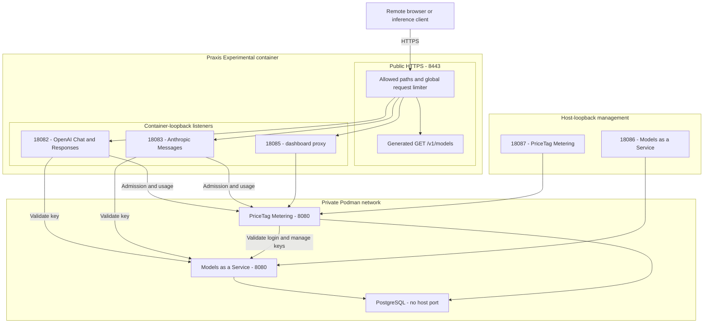

# Remote gateway with PriceTag — architecture

The [quickstart](README.md) runs **Praxis Experimental, Models as a Service,
PriceTag Metering and PostgreSQL on one RHEL host**. Clients use native inference
APIs and scoped dashboards through one HTTPS endpoint. Models run at external
providers or on a separately managed inference server; this gateway needs no GPU,
Kubernetes cluster or identity provider.

This page describes the **pinned quickstart images and generated configuration**.
Models as a Service and PriceTag Metering include fork changes; replacing them
with upstream `main` is not a supported upgrade. See [image options](images.md)
for sources, immutable image selection and source builds.

## Components and connections

| Component | Responsibility |
| --- | --- |
| **Secure Single Server** | Install services, configure TLS and protected secrets, generate provider/model routes, check readiness and provide API-backed management helpers. |
| **Praxis Experimental / Praxis AI** | Terminate HTTPS, contain public routes, validate inference identity through Models as a Service, request admission, route requests and report usage. |
| **Models as a Service** | Issue, validate, expire and revoke user API keys; retain key ownership and lifecycle metadata. Its standalone runtime removes the Kubernetes runtime dependency. |
| **PriceTag Metering** | Own identities/teams, browser sessions, authorization, USD policy, prices, usage records and scoped dashboards; delegate key operations to Models as a Service. |
| **PostgreSQL** | Persist application state in separate databases with separate database roles. One container serves both applications. |

Services run as rootless Podman containers under the `praxis-svc` systemd user,
managed by Quadlets. They are not launched with `--privileged`. The application
containers use non-root users, dropped capabilities and read-only roots;
PostgreSQL has its own image startup behavior and a writable data volume.
Rootless execution does **not** remove the trusted-service boundary described below.

## Listeners and trust boundaries

Only **8443** is publicly published by this application stack. Initial cloud
rules restrict it and SSH to approved source IPs. Models as a Service and
PriceTag Metering are also reachable on **host loopback** for SSH management;
the private Praxis listeners are on **container loopback**. These are different
network boundaries. Generated units and environment are defined by
[`prepare.py`](../../../scripts/pricetag/prepare.py).

### Inference authentication and accounting

1. The client supplies its Models as a Service key as OpenAI `Authorization:
   Bearer` or Anthropic `x-api-key`. These are opaque finite API keys, not
   manually signed JWTs. Gateway key-validation caching is disabled.
2. Praxis derives identity from validation, rejects untrusted identity headers
   and unsupported model/path combinations, and requests PriceTag admission.
   Admission fails closed when PriceTag is unavailable.
3. The configured alias selects a provider connection. Praxis rewrites it to
   the upstream model ID and injects that provider's server-held credential.
4. Response usage is reported to PriceTag and charged to the user's identity.
   Multiple keys do not create independent user budgets.

The default ordinary-user allowance is $5/month with per-user overrides.
PriceTag also retains a **10-billion-token monthly safety gate**; there is no
Praxis `token_rate_limit` filter in this deployment. USD admission is not a
reservation: cached decisions, concurrent requests and delayed usage can cause
overshoot. Global post-USD-limit exceptions permit specified **metered model IDs**;
they neither reroute requests nor bypass the independent token gate.
See [budgets](users.md), [pricing](pricing.md) and [quota testing](../../testing/pricetag-perf.md#usd-quota-probe).

### Browser authentication and authorization

Praxis strips caller identity/authorization headers from dashboard requests and
forwards the login form or cookie. **PriceTag validates browser authentication**:
it exchanges a valid Models as a Service key for an HMAC-signed session cookie,
then verifies its signature and expiry. The pinned deployment uses `Secure`,
`HttpOnly`, `SameSite=Lax` cookies with a seven-day lifetime.

The fork checks live account state, role and data scope. Personal views are
owner-scoped; managers see their reporting subtree. Personal-key operations
remain owner-only even for administrators; impersonation is read-only for
business changes. A revoked/expired inference key cannot validate again, but
**key revocation does not invalidate an existing browser session**. Suspension
blocks the account. See [users and offboarding](users.md#limits).

### Certificates, secrets and private peers

The installer creates a private CA and server certificate. Clients trust the
**public CA certificate** and validate the server's chain, expiry and IP/DNS SAN.
CA/server private keys stay protected on RHEL. This TLS check happens in the
client and Praxis TLS listener, not in an authentication filter. Browser trust
and OpenCode trust must each be configured; see [client setup](clients.md).

Provider credentials are versioned Podman secrets; generated configuration uses
secret references. PriceTag admission/reporting uses a service credential.
The deployed internal service transport is HTTP, not mTLS. Models as a Service
trusts identity assertions from selected host-loopback and fixed container
addresses. **Host administrators, Praxis and PriceTag are privileged peers in
this protocol**, even though their containers are rootless. A compromised trusted
peer could assert administrative identity; public route containment does not
solve that internal boundary. See [hardening follow-up #58](https://github.com/redhat-et/secure-single-server/issues/58).

## Models, routing and prices

Provider setup stores endpoint/secret references and reviewed model metadata.
The generator creates native protocol chains, inline `intelligent_route`
candidates, alias rewrites, an upstream-model allowlist and the public catalog.
Changing providers/models regenerates configuration and restarts the gateway
with readiness/rollback checks. It is not a hot-reloaded provider-management API.

- **Discovery:** `GET /v1/models` is an unauthenticated generated static response.
  It exposes configured aliases and API/context/output metadata, not keys or
  usage. It is not a per-user authorization result and does not use `model_catalog`.
- **Routing:** inline `intelligent_route` selects the connection; separate JSON
  rules rewrite the model. The pinned filter does not provide the newer overlay
  `target_model` contract. The [routing reference](../../development/pricetag-routing.md)
  explains the generated candidates and body-processing hooks.
- **Pricing:** PriceTag imports rates and applies discounts; the fork also supports
  manual rates that survive refresh. Price lookup uses the **reported model ID**,
  not `(provider, model)`. Two aliases rewritten to the same ID share a rate.
  Publishing a route does not establish its price, and adding a price does not
  publish a model. Usage charts show observed usage, not the gateway catalog.

Use [provider/model operations](providers.md) and [price operations](pricing.md)
for changes. The standalone provider editor is not installed.

Filter responsibilities and implementation sources

[`gateway.py`](../../../scripts/pricetag/gateway.py) composes the public and private
listeners around the [model renderer](../../../scripts/common/unified_config.py)
and [provider renderer](../../../scripts/common/provider_config.py). These are
generated chains; filter hooks can run in body pre-read phases, so textual order
alone does not describe the complete request lifecycle.

| Location | Filters and responsibility |
| --- | --- |
| Public edge | `request_id`, `static_response`, `rate_limit`, `router`, `load_balancer`: correlation, route/method containment, catalog, global request protection and dispatch. |
| Native inference | `api_key_auth`, `identity_header_guard`, `model_access`: external key validation, identity protection and configured upstream-model checks. The first and third are supplied by the pinned Red Hat ET Praxis AI fork. |
| Model selection | `model_to_header`, `json_body`, `static_response`, `intelligent_route`: preserve the body-derived alias, reject unsupported choices, select a connection and rewrite the model. |
| Metering | `external_metering`, `token_count`: admission and usage reporting/extraction. Messages token-count requests are excluded from usage extraction. |
| Provider forwarding | `credential_injection`, `headers`, `load_balancer`; `anthropic_messages_protocol` on Messages: select credentials/headers and handle the native upstream protocol. |
| Dashboard proxy | `headers`, `router`, `load_balancer`: remove caller identity headers and forward allowed browser/API routes. PriceTag owns session and role checks. |

## Differences from Kubernetes / OpenShift

The table compares deployment models. It does not describe a particular cluster
or hosted service. Authentication, routing and spending policy remain application
responsibilities in either environment.

| Area | This single-server quickstart | Kubernetes / OpenShift deployment model |
| --- | --- | --- |
| Service lifecycle | Rootless Podman containers managed by systemd Quadlets on one host. | Controllers manage workloads and reconcile declared state across cluster nodes. |
| Network entry | Praxis terminates HTTPS and proxies allowed inference and dashboard routes. | An ingress controller or gateway can expose services; OpenShift also provides Routes. TLS termination and dashboard routing depend on configuration. |
| Configuration and secrets | Protected host files, Podman secrets and generated gateway configuration. | ConfigMaps, Secrets and deployment configuration; operators may reconcile application-specific resources. Secret storage alone does not define application authorization. |
| Identity and keys | Models as a Service standalone runtime, manually managed users and API-key browser login. | Applications can integrate with cluster authorization and an external identity provider. OIDC is an optional application integration, not a requirement imposed by Kubernetes. |
| Provider/model management | SSH helpers validate configuration, regenerate routes and restart with readiness/rollback checks. | APIs/controllers can reconcile model and provider resources when that integration is implemented. Kubernetes does not automatically supply a provider-management UI or routing policy. |
| Storage and availability | One PostgreSQL container, separate application databases and a host-local volume. The host is a single failure domain. | Persistent volumes or external database services can support different availability designs. Replication, backup and application recovery still require explicit configuration. |
| Budgets, pricing and sessions | The pinned application images provide the documented APIs, UI and authorization behavior. | The same concerns depend on application versions and configuration. Cluster deployment does not itself add budget enforcement, session invalidation or pricing management. |

A future standalone provider UI needs a narrow adapter for validated changes,
secret replacement, revision checks and activation/rollback. Reuse the application
UI where suitable; keep Podman access and host execution in Secure Single Server.
This is follow-up work, not a reason to introduce a Kubernetes API into the host.

## Qualification and remaining work

[Core tracking #45](https://github.com/redhat-et/secure-single-server/issues/45)
and [follow-up #58](https://github.com/redhat-et/secure-single-server/issues/58)
cover source convergence, stronger service authentication, authenticated catalog
access, session invalidation, storage retention, recovery and release qualification.
The installer is for fresh hosts, not a coordinated upgrade/rollback system.
Public DNS/certificate automation and OIDC are not configured by this quickstart.

[Inference guards #100](https://github.com/redhat-et/secure-single-server/pull/100)
adds explicit upgrade rejection and further streaming-accounting qualification;
those changes are not part of this page's merged baseline. A working stream is
not proof that cancellation/failure accounting is complete.

For evidence and limitations, use the [pilot reference](../../testing/pricetag.md),
[mock API/browser suite](../../testing/pricetag-demo-ci.md) and
[performance procedure](../../testing/pricetag-perf.md).
