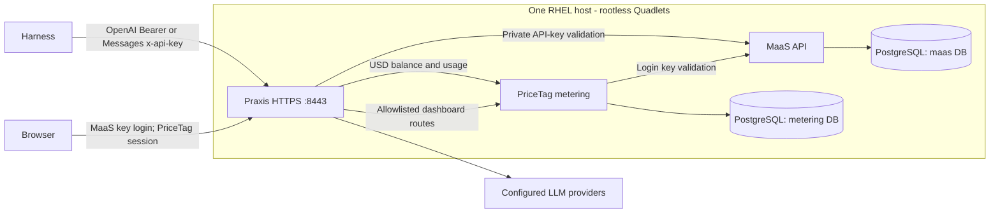

# Single-server gateway with MaaS and PriceTag

This deployment runs Praxis, the cluster-free MaaS API, PriceTag metering and
PostgreSQL on one RHEL host. Praxis is the only public application listener:
HTTPS 8443 serves inference and the PriceTag browser UI. MaaS, PostgreSQL and
metering stay on the private Podman network. Clients authenticate with finite
MaaS API keys; this deployment does not issue JWTs.

MaaS owns finite inference keys and their identity. An administrator sets the
maximum lifetime with `API_KEY_MAX_EXPIRATION_DAYS`; users may request a shorter
duration. The initial RHEL profile uses 90 days. `scripts/pricetag/maas-key`
creates, lists, rotates and revokes keys through MaaS APIs. The one-time secret
is stored in a new mode-0600 file; replacement is saved before the prior key is
revoked. `scripts/pricetag/user` links the same subject to a PriceTag identity,
sets an optional USD override, and then provisions the key.

Praxis validates OpenAI requests with the `Authorization: Bearer` header and
Anthropic Messages requests with `x-api-key`. Identity comes from MaaS validation,
not caller-supplied `x-tenant-*` headers. The public gateway catalog is served from the
configured model list and includes each model's API, context and output limits.
Provider setup and replacement use `scripts/pricetag/providers`; presets and
reviewed PriceTag source prices live in `configs/pricetag/`.

The gateway uses PriceTag's USD balance policy as its spending limit and retains
the 10-billion monthly token safety gate. It does not configure Praxis'
`token_rate_limit` filter. Missing prices use [fallback estimates](../quickstarts/remote-gateway-pricetag/pricing.md#missing-price-fallback);
review or set rates before enabling real traffic. Admission fails closed when the balance service is unavailable. The
metering service caches quota decisions for 15 seconds, so a request burst can
continue on a previously allowed balance after spend crosses the limit. The
mock quota probe measured this overage; treat the USD limit as an enforced
admission threshold with a bounded stale-decision window, not an exact spend
ceiling. See the [quota probe results](pricetag-perf.md#usd-quota-probe).

## Network and service boundary

Only TCP 8443 is published publicly. The MaaS API binds to a host loopback
port for SSH administration and accepts trusted identity headers from host
loopback plus fixed `/32` addresses for MaaS's own published-port path, Praxis,
and PriceTag's MaaS key validator. Startup selects these addresses on the
private network; other containers on that network are outside MaaS's trusted
CIDRs. PostgreSQL and PriceTag machine APIs remain unpublished. PriceTag's M2M
bearer check is enabled; Praxis reads its matching token from a Podman secret
mounted only into its container. The performance mock uses a separate network.

The host, Praxis and PriceTag are privileged peers: anyone with host access can
call the loopback MaaS API with trusted identity headers, and a compromised
Praxis or PriceTag container can assert the configured admin group. Protect SSH
and the host, and keep the private network limited to these services. This
design excludes unrelated containers; isolating MaaS administration from a
compromised gateway or metering service requires a separate authenticated
admin boundary before broader use.

The browser logs in with a MaaS key. PriceTag exchanges it for its existing
Secure/HttpOnly session cookie. Inference-key expiry and browser-session expiry
are independent. Revoking a MaaS key prevents later validation, while an
already established browser cookie may remain valid until it expires. The pinned demo image supports administrator, personal and manager dashboards.
Personal views are identity-scoped; manager views are limited to the reporting
subtree. Suspending an identity blocks its sessions and inference. See
[users and keys](../quickstarts/remote-gateway-pricetag/users.md#limits) for offboarding limits.

## Deploy and test

Use the [AWS-to-RHEL runbook](../quickstarts/remote-gateway-pricetag/README.md) for fresh real and performance
hosts. It covers VM launch, source transfer, image builds, Quadlet setup,
provider configuration, key/budget provisioning, browser login and OpenCode.
The performance VM uses a synthetic provider and a separate MaaS issuer/database.
Never put real provider credentials on that host.

Run the [performance procedure](pricetag-perf.md) only after the protocol and
budget acceptance checks pass. It records request latency, container resources,
database size, disk use and exact per-user ledger totals. The metering build has
no automatic raw-event retention deletion. Keep enough disk for the retained
ledger and backups; define and test a retention policy before long-lived use.

## Current implementation dependencies

- The pinned MaaS image contains the reviewed cluster-free runtime changes;
  the standard Kubernetes image is not a substitute. Published images and source
  builds are described in [image options](../quickstarts/remote-gateway-pricetag/images.md).
- Praxis must contain ET `api_key_auth` and the reviewed external-metering
  integration. The combined experimental image must be pinned by digest.
- The PriceTag image includes fork changes for scoped dashboards and management.
  Automatic session invalidation on key revocation and encrypted off-host
  backup/restore remain separate work.

These are release gates. Do not treat a successful container start as proof
that the complete single-server service is ready for users.
